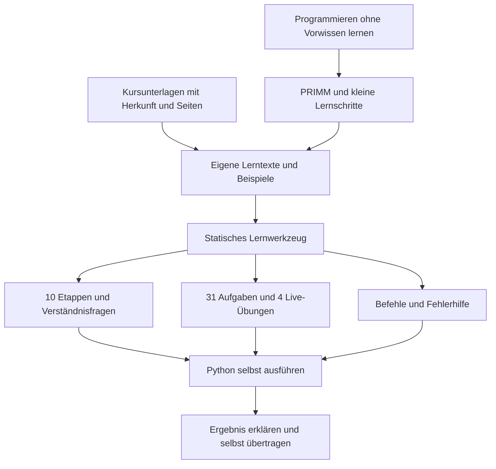
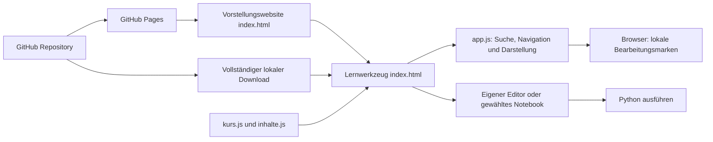

# Die Gesamtkarte in drei Ansichten

Die bewegliche Gesamtkarte liegt in [[CuD Gesamtkarte.canvas]]. Die folgenden Diagramme zeigen Zweck, System und Pflegeprozess in kompakter Form. Die verlinkten Notizen liefern die Einzelheiten.

## Vom Ziel zur Anwendung

Zweck: [[10 Ziel und Umfang]] · Vorgehen: [[11 Lernmodell und Arbeitsweise]] · Forschung: [[12 Wissenschaftliche Grundlagen]].

## Technisches System

Eine Verbindung von Bearbeitungsmarken zu einem Server besteht im derzeitigen Code nicht. GitHub Pages liefert Dateien aus; Python läuft außerhalb des Lernwerkzeugs. Siehe [[20 Technische Architektur]] und [[41 Lokal Cloud und Synchronisation]].

## Inhalte pflegen und veröffentlichen

```mermaid
flowchart LR
  O[Quelle und Nutzungsumfang klären] --> S[Seiten sichten und Lernziel festlegen]
  S --> C[Lektion oder Übung ergänzen]
  C --> P[Unabhängige Erwartungen und Fehlerfälle]
  P --> B[Browser und Bedienung prüfen]
  B --> R[Diff und Originalhashes kontrollieren]
  R --> M[Manifest bewusst aktualisieren]
  M --> PR[Pull Request und CI]
  PR --> F[Freigegebene Dateien veröffentlichen]
```

Anleitungen: [[30 Neue Vorlesung hinzufügen]], [[31 Neue Übung hinzufügen]], [[32 Entwicklung und Release]]. Öffentlich sichtbare Dateien und die Veröffentlichung müssen gemeinsam betrachtet werden: [[42 GitHub Repositoryplan]], [[43 Sichtbarkeit für Besucher]], [[44 Sicherheit und Datenschutz]].

Weiter: [[00 Start]] · [[90 Stand und Nachweise]] · [[91 Quellenverzeichnis]]
