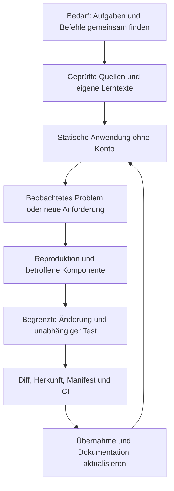

# Die Hauptreferenz für das gesamte CuD-Projekt

Diese Wissensbasis soll ermöglichen, CuD ohne Rekonstruktion alter Chats zu verstehen, einen Fehler einzugrenzen, eine kleine Reparatur zu prüfen und die nächste Erweiterung kontrolliert umzusetzen. Der aktuelle Ausgangspunkt ist der zusammengeführte Repositorystand `b784b9b`; eine ältere Release-ZIP ist ein anderer Stand.

## Welche Frage führt wohin?

| Frage | Einstieg | Ergebnis |
| --- | --- | --- |
| Wofür wurde das Projekt geschaffen? | [[10 Ziel und Umfang]] und [[27 Entscheidungen und Baugeschichte]] | Zielgruppe, ursprüngliches Problem und bewusste Grenzen |
| Wie funktioniert es intern? | [[24 Laufzeit und Datenflüsse]] | Skriptreihenfolge, Daten, Suche, Navigation, Zustand und Python-Ausführung |
| Eine Funktion ist kaputt. Was prüfe ich zuerst? | [[25 Diagnose und Reparatur]] | Symptom, Reproduktion, zuständige Datei und Erfolgsnachweis |
| Wo liegt eine bestimmte Funktion? | [[28 Komponenten und Einstiegspunkte]] | Aktuelle Funktionsnamen und verlinkte Quellstellen |
| Wie stelle ich das Projekt wieder her? | [[26 Wiederaufbau und Arbeitsumgebung]] | Sauberer Checkout, Laufzeit, Tests und Integritätsprüfung |
| Wie ergänze ich Inhalte? | [[30 Neue Vorlesung hinzufügen]] und [[31 Neue Übung hinzufügen]] | Tatsächlicher Datenvertrag und getrennte Prüffälle |
| Warum ist es so gebaut? | [[27 Entscheidungen und Baugeschichte]] | Entscheidungen mit Herkunft, Alternativen und Folgewirkung |
| Welche Forschung steckt dahinter? | [[12 Wissenschaftliche Grundlagen]] | Nachweis der PRIMM-Auswahl und getrennte ergänzende Literatur |
| Welche Aussagen sind belegt? | [[23 Qualität und Prüfungen]] und [[94 Gesprächs- und Quellenabgleich]] | Code-/GitHub-Nachweis, Gesprächskontext und offene Prüfung |
| Was darf veröffentlicht werden? | [[43 Sichtbarkeit für Besucher]] und [[44 Sicherheit und Datenschutz]] | Öffentliche Dateien, persönliche Daten und ungeklärte Rechte |

## Der Zusammenhang

## Wann diese Referenz verbindlich ist

Der tatsächlich geprüfte Code und datierte Prüfergebnisse bestimmen das Verhalten. Ein Chat erklärt Bedarf oder Absicht; er beweist keinen späteren Merge. Der aktuelle Git-Commit belegt die Dateien; ein Release steht für seinen eigenen Paketstand. Forschung begründet die didaktische Auswahl, misst aber nicht automatisch die Wirksamkeit von CuD.

Zur nächsten Sitzung zuerst Commit und Arbeitsbaum prüfen, dann diese Seite und das passende Diagnosekapitel lesen. Die Wissensbasis ist gepflegte Projektdokumentation; bei jeder Änderung müssen betroffene Datenverträge, Quellen und Nachweise mitgepflegt werden.

## Geprüfte Projektquellen

- [README.md](https://github.com/Sae-l/CuD/blob/b784b9bed47ba9232c0e121b0f496a6dd75b119d/README.md)
- [ARBEITSPLAN_Lernwerkzeug.md](https://github.com/Sae-l/CuD/blob/b784b9bed47ba9232c0e121b0f496a6dd75b119d/ARBEITSPLAN_Lernwerkzeug.md)
- [Lernwerkzeug/LERNKONZEPT.md](https://github.com/Sae-l/CuD/blob/b784b9bed47ba9232c0e121b0f496a6dd75b119d/Lernwerkzeug/LERNKONZEPT.md)

Weiter: [[03 Projektleitfaden]] · [[00 Start]] · [[94 Gesprächs- und Quellenabgleich]]
