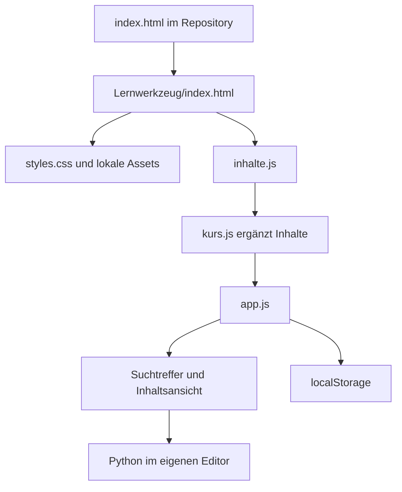

# Eine statische Anwendung mit getrennten Inhaltsdaten

CuD besteht aus HTML, CSS und JavaScript. Die Nutzung erfordert keinen Buildschritt, kein Backend und kein Benutzerkonto. Die öffentlich vorgeschaltete Startseite und der eigentliche Lernraum sind zwei getrennte HTML-Einstiege.

## Zuständigkeiten der Dateien

| Datei | Aufgabe |
| --- | --- |
| Root `index.html` | Vorstellung, Inhaltsüberblick, Online- und Downloadzugang |
| `Lernwerkzeug/index.html` | Lernnavigation, Suchfeld und Platzhalter für Inhalte |
| `styles.css` | Layout, Fokus, schmale Ansichten und reduzierte Bewegung |
| `inhalte.js` | Grundinhalte, Aufgaben, Befehle, Quellen und Fehlerhilfe |
| `kurs.js` | Vorlesungen, Einrichtung, zusätzliche Befehle, Live-Aufgaben und Ergänzungen |
| `app.js` | Suchindex, Datenzuordnung, Hash-Navigation, DOM und Bearbeitungsmarken |
| `beispiele/` | Eigene CSV-Dateien für ausführbare Beispiele |
| `assets/` | Lokal ausgelieferte Schrift, Foto und Animationsbibliotheken |

Die Skripte werden mit `defer` in der Reihenfolge `inhalte.js`, `kurs.js`, `app.js` geladen. Der Renderer muss die bereits vervollständigten Inhaltsdaten sehen. Ein neues Framework ist für die derzeitige Größe nicht erforderlich.

## Daten und Navigation

Inhaltseinträge tragen stabile IDs. Einträge werden über eine ID-Zuordnung gefunden, Verweise in `needs` und `related` verbinden sie. Vorlesungsreihenfolge, Themenfilter und Anzahl werden weitgehend aus den Daten erzeugt. Hash-Adressen wie `#vorlesungen` oder `#aufgabe-6-1` erlauben direkte Einstiege.

Die Suche normalisiert unter anderem Umlaute und Großschreibung. Sie berücksichtigt Suchwörter in Titeln, Aliasen und Erklärungen und gewichtet bestimmte Treffer stärker. Mathematische Operatoren bleiben suchbar. Es gibt keinen externen Suchdienst und kein Sprachmodell im Laufzeitpfad.

## Speicherung und Vertrauensgrenzen

`app.js` speichert bearbeitete Vorlesungs-IDs unter `cud-lernfortschritt-v1` im Browser. Ungültige Einträge werden gefiltert; bei blockiertem Speicher bleibt Sitzungsbetrieb. Der gleiche Schlüssel bedeutet auf einer anderen Websiteadresse keinen gemeinsamen Speicher. Ein Wechsel von `file://` zu HTTPS oder zu einem anderen Browser kann daher wie ein neuer Lernstand wirken.

Inhalte sind vom Repository kontrollierter JavaScript-Code. Ein Inhaltsbeitrag ist ausführbarer Code und muss reviewt werden. Die geprüften Darstellungshelfer setzen Texte mit `textContent`; das entbindet nicht von einer Prüfung neuer Renderingpfade. Eine offene Eingabeplattform für fremde HTML-Inhalte ist nicht vorhanden.

Entwicklung: [[32 Entwicklung und Release]]. Datenschutz: [[44 Sicherheit und Datenschutz]].

## Projektbelege

- [index.html](https://github.com/Sae-l/CuD/blob/bdff10b0918473d8a37e05141a85fdf37c762c4d/index.html)
- [Lernwerkzeug/index.html](https://github.com/Sae-l/CuD/blob/bdff10b0918473d8a37e05141a85fdf37c762c4d/Lernwerkzeug/index.html)
- [Lernwerkzeug/app.js](https://github.com/Sae-l/CuD/blob/bdff10b0918473d8a37e05141a85fdf37c762c4d/Lernwerkzeug/app.js)
- [Lernwerkzeug/kurs.js](https://github.com/Sae-l/CuD/blob/bdff10b0918473d8a37e05141a85fdf37c762c4d/Lernwerkzeug/kurs.js)
- [Lernwerkzeug/inhalte.js](https://github.com/Sae-l/CuD/blob/bdff10b0918473d8a37e05141a85fdf37c762c4d/Lernwerkzeug/inhalte.js)

Weiter: [[00 Start]] · [[90 Stand und Nachweise]] · [[91 Quellenverzeichnis]]

Detaillierter Laufweg: [[24 Laufzeit und Datenflüsse]]. Zuständige Quellstellen: [[28 Komponenten und Einstiegspunkte]].
