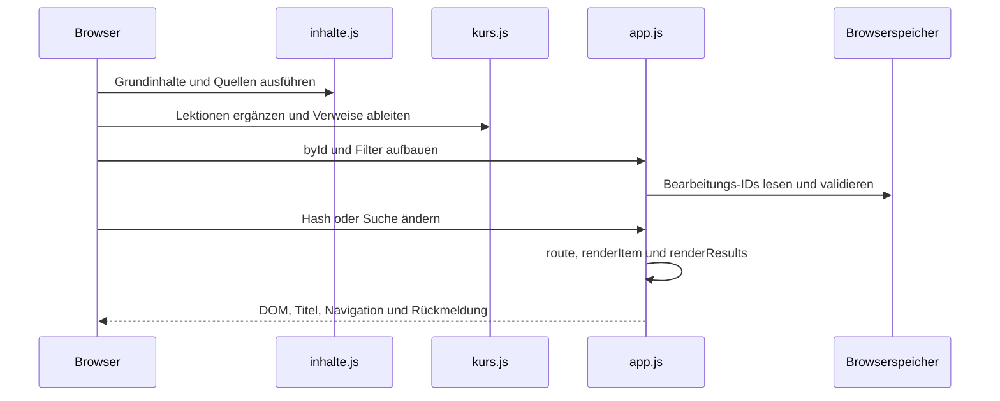

# Wie CuD tatsächlich arbeitet

## 1. Website und Inhalte laden

Die Root-`index.html` stellt das Projekt vor. `Lernwerkzeug/index.html` lädt lokale Gestaltung und die drei Anwendungsskripte mit `defer`. `inhalte.js` definiert Grundinhalte und Quellen. `kurs.js` ergänzt Lektionen, Einrichtung, Befehle und Live-Aufgaben. Erst danach baut `app.js` seine ID-Zuordnung und Oberfläche auf.

In `kurs.js` erzeugt die Schleife über `vorlesungen.entries()` je Lektion eine Quellen-ID, `kind`, `explanation`, `sources`, voreingestellte Voraussetzungen und den nächsten Schritt. Diese Ableitungen sind Teil des Datenvertrags. Ein Objekt nur am Dateiende anzuhängen ersetzt nicht seine Aufnahme vor dieser Schleife.

## 2. Suchen und navigieren

`normalize()` vereinheitlicht Schreibweisen und erhält unterstützte Operatoren. `findItems()` berücksichtigt Titel, Aliase und offene Erklärungen, verlangt passende Suchwörter und sortiert nach Gewichtung. Hinweise, Lösungscode und Quizantworten werden nicht in den Suchkontext aufgenommen. `renderResults()` stellt die Treffer dar.

`route()` liest den Hash, beendet vorherige Startseitenanimationen und wählt Inhalt oder Übersicht. Anschließend werden Seitentitel, aktive Navigation und Treffer aktualisiert. Wenn Fokus angefordert ist, schließt sich die mobile Navigation und der Fokus springt nach dem Rendern zum Inhalt. Eine neue Route betrifft deshalb Darstellung, Verlauf, Fokus und gegebenenfalls Animationsaufräumen gleichzeitig.

## 3. Lernen und Markierungen

`renderItem()` baut Lernziel, Erklärungen, Code, Quellen, Hinweise und getrennte Lösungsklappen. `renderQuiz()` vergleicht die gewählte Option mit dem konfigurierten Index und begründet die Rückmeldung. Es führt kein frei geschriebenes Programm der Person aus.

`renderProgress()` verändert die Menge bearbeiteter IDs und versucht, sie unter `cud-lernfortschritt-v1` lokal zu speichern. Ein Speicherfehler schaltet auf Sitzungsbetrieb. Browserprofil, Webadresse und `file://` können unterschiedliche Speicherbereiche haben. Die Daten fließen nicht automatisch zu GitHub oder einem Konto.

## 4. Python und Dateien

Das Lernwerkzeug zeigt Python und stellt CSV-Dateien bereit. Lernende starten das Programm im eigenen Interpreter. Für ein Cloud-Notebook kopierte Daten sind ein bewusst gewählter zusätzlicher Datenfluss. `live-mini.csv` bleibt eine synthetische Demonstration; die fehlende `bb12024.csv` wird dadurch nicht geprüft.

## 5. Die Prüfstrecke

`pruefen.cjs` lädt die Inhaltsdateien in eine Node-VM, kontrolliert IDs, Quellen und Pflichtfelder und übergibt Beispiele an den ausgewählten Python-Prozess. Anschließend laufen Browserprüfungen für Inhalte, Suche, Downloads und Bedienung. Ein gemeinsamer Fehlerabschluss schreibt FAIL. `kompatibilitaet.cjs` prüft Ansichten über drei Engines und sieben Größen an einem Loopback-Server. Dieser Testserver liefert eine begrenzte Dateiliste; er ist kein allgemeiner Quellen- oder Downloadserver.

## 6. Integrität und Release

Das Projektmanifest dokumentiert konkrete Bytes. CI prüft Manifest, Vault, Unit-Tests und Anwendung. Der Tag-Workflow prüft erneut, stellt anschließend seine erzeugten Anwendungsnachweise auf die Commit-Version zurück und baut ein ZIP aus den manifestierten Dateien. Dadurch muss ein CI-Artefakt nicht dieselben Zeitstempel wie ein Report im Release besitzen. Vergleichbar bleiben jeweils Commit, Umfang und Ergebnis.

Fehler entlang dieses Wegs behandelt [[25 Diagnose und Reparatur]]. Die zugehörigen Quellstellen stehen in [[28 Komponenten und Einstiegspunkte]].

## Geprüfte Projektquellen

- [Lernwerkzeug/index.html](https://github.com/Sae-l/CuD/blob/b784b9bed47ba9232c0e121b0f496a6dd75b119d/Lernwerkzeug/index.html)
- [Lernwerkzeug/kurs.js](https://github.com/Sae-l/CuD/blob/b784b9bed47ba9232c0e121b0f496a6dd75b119d/Lernwerkzeug/kurs.js)
- [Lernwerkzeug/app.js](https://github.com/Sae-l/CuD/blob/b784b9bed47ba9232c0e121b0f496a6dd75b119d/Lernwerkzeug/app.js)
- [Lernwerkzeug/pruefen.cjs](https://github.com/Sae-l/CuD/blob/b784b9bed47ba9232c0e121b0f496a6dd75b119d/Lernwerkzeug/pruefen.cjs)
- [Lernwerkzeug/kompatibilitaet.cjs](https://github.com/Sae-l/CuD/blob/b784b9bed47ba9232c0e121b0f496a6dd75b119d/Lernwerkzeug/kompatibilitaet.cjs)
- [scripts/release.py](https://github.com/Sae-l/CuD/blob/b784b9bed47ba9232c0e121b0f496a6dd75b119d/scripts/release.py)
- [.github/workflows/release.yml](https://github.com/Sae-l/CuD/blob/b784b9bed47ba9232c0e121b0f496a6dd75b119d/.github/workflows/release.yml)

Weiter: [[03 Projektleitfaden]] · [[00 Start]] · [[94 Gesprächs- und Quellenabgleich]]
