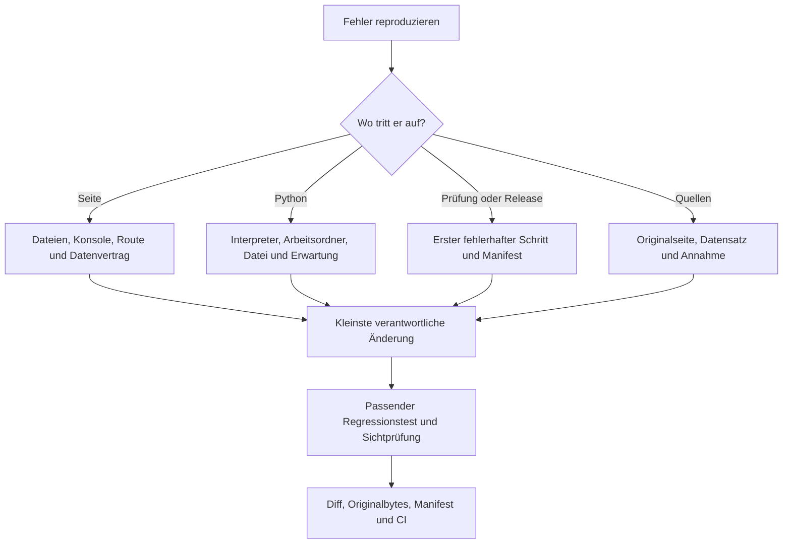

# Vom beobachteten Fehler zur nachgewiesenen Reparatur

## Zuerst den Fall festhalten

Notiere Commit oder Release, Gerät, Betriebssystem, Browser, URL beziehungsweise Dateiöffnung, genaue Schritte, erwartetes und tatsächliches Verhalten. Trenne eine falsche Ausgabe des eigenen Python-Programms von einem Fehler der Lernseite. Vorhandene Lernstandsmarken nicht vorschnell löschen; sie können Teil der Reproduktion sein.

## Symptom → Untersuchung → Nachweis

| Symptom | Zuerst prüfen und zuständige Stelle | Geeigneter Nachweis |
| --- | --- | --- |
| Leere Seite oder JavaScript-Fehler | Ganze Ablage vorhanden? Erste Konsolenmeldung? Reihenfolge in Lern-`index.html`, Syntax in Inhaltsdateien | Start und betroffene Ansicht laden; keine Seitenfehler; Inhaltsprüfung |
| „Inhalt nicht gefunden“ | Hash exakt mit Inhalts-ID vergleichen; `byId` und `route()` in `app.js`; ID vor Renderbeginn verfügbar? | Direkte Adresse, interner Link und Zurück/Vorwärts |
| Neue Lektion fehlt | Objekt vor der Ableitungsschleife in `kurs.js`? Eindeutige ID, Pflichtfelder und vorhandene Quellen? | Dokumentationsbeispielprobe und `pruefen.cjs` |
| Ein Begriff wird nicht gefunden | Filter zurücksetzen; `normalize()`, `findItems()`, Aliase und offene Erklärungsblöcke | Erwartete Inhalts-ID für Suchwort, Umlaut oder Operator |
| Lösung erscheint in Vorschau | Neu aufgenommene Suchfelder und `summary` kontrollieren; Antwort nicht aus geschützten Feldern übernehmen | Suchtreffer ohne Lösungsantwort, vollständige Lösung weiterhin bewusst öffnbar |
| Fortschritt scheint verschwunden | Gleicher Browser und gleiche Herkunft? Speicherung blockiert? Stabile Inhalts-ID? `renderProgress()` | Setzen, Reload, Entfernen und blockierten Speicher getrennt testen |
| PDF oder CSV fehlt | Relativen Pfad vom Lernordner aus auflösen; vollständiger Download; `quellen`, `sourceFile`, `download` | Datei vorhanden, Link erreichbar und Downloadbytes gleich Testdatei |
| Live-Programm sucht bb12024.csv | Kopierte aktuelle Lösung und Hauptaufruf prüfen; Demo erwartet `live-mini.csv` | Ausgelieferten Hauptaufruf mit ausgeliefertem Download ausführen |
| FileNotFoundError im eigenen Code | Tatsächlicher Arbeitsordner, Dateiname und Erweiterung; nicht nur Speicherort von main.py | `Path.cwd()` und Existenz genau des verwendeten relativen Pfads |
| Anderes numerisches Ergebnis | Datensatz, Spalte, Einheiten, NaN und konkrete Filtergrenze mit Originalauftrag vergleichen | Unabhängig gerechneter kleiner Prüffall; Annahme sichtbar |
| Mobil Überlauf oder unzugänglicher Knopf | `styles.css`, Größen, Fokus und Menüstatus; Tabellen intern scrollen | Betroffene Breite, Tastatur, Touch und reduzierte Bewegung |
| Animation bleibt nach Navigation | `route()`, `startMotion` und `syncMotion()`; vorherige Trigger bereinigt? | Vor/nach Routenwechsel und nach Umschalten reduzierter Bewegung |
| Test bleibt RUNNING oder meldet FAIL | Ersten Fehler lesen; Interpreter und Pakete, Python-Rückgabecode, gemeinsamen Fehlerabschluss prüfen | Erfolgs- und echter Fehlerfall erzeugen den richtigen Status |
| Browser startet nicht | Browserpakete, Version, Profil-/Temp-Pfad und Betriebssystemvoraussetzungen | Start mit beschreibbarem temporärem Projektpfad; kein Abschalten von Schutzrichtlinien |
| PROJECT_MANIFEST_FAIL | Genannte Dateien gegen Git-Diff und ursprüngliche Hashwerte prüfen | Nur beabsichtigte Änderungen nach Review mit --write erfassen; --check wiederholen |
| Vaultprüfung scheitert | Fehlender Link, doppelte Notiz, Canvas-Dateipfad oder abweichende Konfiguration? | Inhaltlich prüfen, Links reparieren, dann bewusst Vaultmanifest erneuern |
| CI rot nach Paketupdate | Lockdatei, Paket-Diff und Manifest zusammen prüfen; nicht Manifest automatisch in CI schreiben | Begrenzter Update-Diff und vollständige erforderliche CI-Prüfung |
| Pages aktualisiert sich nicht | Deployment am richtigen Commit? Veröffentlichungsquelle und relativer Projektpfad? | Aktueller Deploymentlauf und HTTP-/Browserprüfung beider Einstiege |
| Releasepaket wird abgelehnt | Tag-/Paketversion und Manifest; `pack()` in release.py | Passende stabile Version, geprüfte Bytes und SHA256SUMS |

## Den kleinsten wirksamen Eingriff wählen

Inhalt oder Erwartung falsch → in `inhalte.js`, `kurs.js` oder dem fachlichen Prüffall arbeiten. Such- oder Navigationslogik falsch → `app.js`. Bedienung falsch → betroffene HTML-/CSS-/JS-Stelle. Deploymentquelle falsch → tatsächliche Hostingkonfiguration prüfen; keine Inhaltsdatei als Ersatz für eine Settingskorrektur ändern.

Für eine reine Text- oder Linkkorrektur reichen betroffene Verweise, Vaultprüfung und Integrität. Für Programmverhalten die passende bestehende Regression und betroffene Ansicht prüfen; vor Integration die erforderliche CI bestehen lassen. Keine umfangreiche neue Testarchitektur für einen einfachen Textwechsel schaffen.

## Besonderheit Windows-Temp-Verzeichnis

Frühere lokale Unit-Tests scheiterten an einem nicht beschreibbaren Sandbox-Temp-Pfad. Ein beschreibbarer Ordner unter dem ausgeschlossenen `.upload-work/` wurde für `TEMP` und `TMP` verwendet; die Tests bestanden danach. Das ist ein Umgebungsbefund. Er erlaubt keine pauschale Neuinstallation, Änderung der Ausführungsrichtlinie oder Deaktivierung von Sicherheitsfunktionen.

## Reparatur abschließen

Ursache und reproduzierbaren Fall erklären, nur verantwortliche Dateien ändern, unabhängige Erwartungen prüfen und Originalquellen unverändert lassen. Danach beide Integritätsebenen bewusst aktualisieren, Diff prüfen, CI am tatsächlichen Commit ausführen und die betroffene Wissensseite mitpflegen. Ein grüner Test ersetzt keine Klärung widersprüchlicher Originaldaten.

## Geprüfte Projektquellen

- [Lernwerkzeug/app.js](https://github.com/Sae-l/CuD/blob/b784b9bed47ba9232c0e121b0f496a6dd75b119d/Lernwerkzeug/app.js)
- [Lernwerkzeug/kurs.js](https://github.com/Sae-l/CuD/blob/b784b9bed47ba9232c0e121b0f496a6dd75b119d/Lernwerkzeug/kurs.js)
- [Lernwerkzeug/pruefen.cjs](https://github.com/Sae-l/CuD/blob/b784b9bed47ba9232c0e121b0f496a6dd75b119d/Lernwerkzeug/pruefen.cjs)
- [Lernwerkzeug/kompatibilitaet.cjs](https://github.com/Sae-l/CuD/blob/b784b9bed47ba9232c0e121b0f496a6dd75b119d/Lernwerkzeug/kompatibilitaet.cjs)
- [scripts/manifest.py](https://github.com/Sae-l/CuD/blob/b784b9bed47ba9232c0e121b0f496a6dd75b119d/scripts/manifest.py)
- [scripts/release.py](https://github.com/Sae-l/CuD/blob/b784b9bed47ba9232c0e121b0f496a6dd75b119d/scripts/release.py)
- [AUDIT.md](https://github.com/Sae-l/CuD/blob/b784b9bed47ba9232c0e121b0f496a6dd75b119d/AUDIT.md)

Weiter: [[03 Projektleitfaden]] · [[00 Start]] · [[94 Gesprächs- und Quellenabgleich]]
