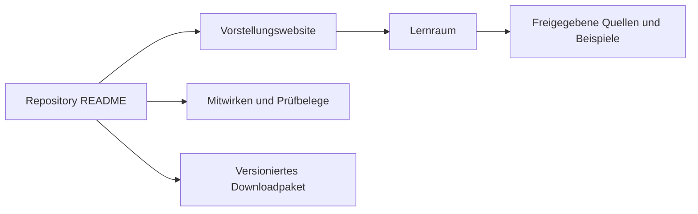

# Tatsächlicher Aufbau und künftiger Veröffentlichungsumfang

Aktuelles Repository: [Sae-l/CuD](https://github.com/Sae-l/CuD). Am 16.10.2026 per Connector als **public** mit Standardbranch `main` bestätigt. Die folgenden bestehenden Hauptpfade wurden am gelesenen Stand und in der Arbeitsablage geprüft. `Obsidian-CuD/` ist das Ergebnis dieses Dokumentationsauftrags. Der zur Veröffentlichung vorbereitete Stand liegt auf dem Branch `docs/obsidian-cud-vault`; er wird über einen Pull Request zur Übernahme vorgeschlagen.

```text
CuD/
├── index.html                 Vorstellungswebsite, im aktuellen Remote
├── README.md                  Einstieg für Repositorybesucher
├── Lernwerkzeug/
│   ├── index.html             Lernoberfläche
│   ├── styles.css
│   ├── inhalte.js             Grundinhalte und Aufgaben
│   ├── kurs.js                Lektionen und Ergänzungen
│   ├── app.js                 Darstellung, Suche, Zustand
│   ├── assets/                Lokale Gestaltung und Lizenzhinweise
│   ├── beispiele/             Eigene CSV-Dateien
│   ├── pruefung/              Gespeicherte Softwarebelege
│   └── *.md                   Konzept, Erweiterung und Abdeckung
├── Referenz/                  Originalquellen und Begleitdateien
├── Referenz_Sichtung/         Seitenindex, Auszüge und Herkunft
├── scripts/                   Manifest, Release und fachliche Tests
├── .github/                   Workflows und Dependabot
├── package.json               Node-Vorgaben und Testskript
├── package-lock.json
├── requirements-test.txt      Python-Testpakete
├── PROJEKT_MANIFEST.json       Integritätsstand
├── CONTRIBUTING.md
├── AUDIT.md
└── Obsidian-CuD/              Neue lokale Wissensbasis dieses Auftrags
```

`node_modules/`, `.upload-work/`, virtuelle Umgebungen, Debugprotokolle und `.env` gehören nicht zum veröffentlichten Produkt. Ein `.gitignore` beeinflusst neu zu erfassende Dateien; bereits versionierte Dateien und alte Commits werden dadurch nicht verborgen.

## Wie die Besucher einsteigen



## Vorschlag für eine getrennte Veröffentlichung

Ein künftiger Veröffentlichungsordner kann nur Root-Startseite, Lernwerkzeug, freigegebene Daten, notwendige Quellen und Lizenzhinweise enthalten. Die internen Seitenbezüge müssen dabei erhalten bleiben oder gezielt auf eine freigegebene Quelle umgestellt werden. Ein bloßes Kopieren von `index.html` reicht nicht.

Eine separate private Arbeitsablage kann ungeklärte Originalmaterialien, ausführliche Sichtungsunterlagen und persönliche Arbeitsnotizen aufnehmen. Dieses Modell ist **ein Vorschlag**; die aktuelle öffentliche Repositorykopie enthält bereits Quellenpfade. Eine schlankere Pages-Ausgabe allein verbirgt nichts, was im öffentlichen Git-Repository steht.

## Upload dieser Dokumentation

Vor einer späteren Integration den Vaultinhalt reviewen und entscheiden, ob er als Maintainer-Dokumentation öffentlich sein soll. Persönliche Obsidian-Workspace-Dateien ausschließen. Die neue Dokumentation bewusst ins Projektmanifest aufnehmen und separat vom vorhandenen `.claude/launch.json`-Vorbefund behandeln. Dann über einen begrenzten Pull Request prüfen lassen. Nach dem anschließenden ausdrücklichen Uploadauftrag wird die Wissensbasis über den Branch `docs/obsidian-cud-vault` und einen Pull Request veröffentlicht. Eine Übernahme in main oder eine neue fachliche beziehungsweise Geräteabnahme ist damit nicht gleichzusetzen.

Siehe [[43 Sichtbarkeit für Besucher]], [[44 Sicherheit und Datenschutz]] und [[32 Entwicklung und Release]].

## Projektbelege

- [README.md](https://github.com/Sae-l/CuD/blob/bdff10b0918473d8a37e05141a85fdf37c762c4d/README.md)
- [.gitignore](https://github.com/Sae-l/CuD/blob/bdff10b0918473d8a37e05141a85fdf37c762c4d/.gitignore)
- [.github/workflows/check.yml](https://github.com/Sae-l/CuD/blob/bdff10b0918473d8a37e05141a85fdf37c762c4d/.github/workflows/check.yml)
- [PROJEKT_MANIFEST.json](https://github.com/Sae-l/CuD/blob/bdff10b0918473d8a37e05141a85fdf37c762c4d/PROJEKT_MANIFEST.json)

Weiter: [[00 Start]] · [[90 Stand und Nachweise]] · [[91 Quellenverzeichnis]]
