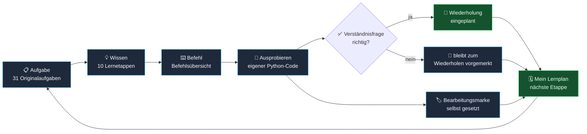
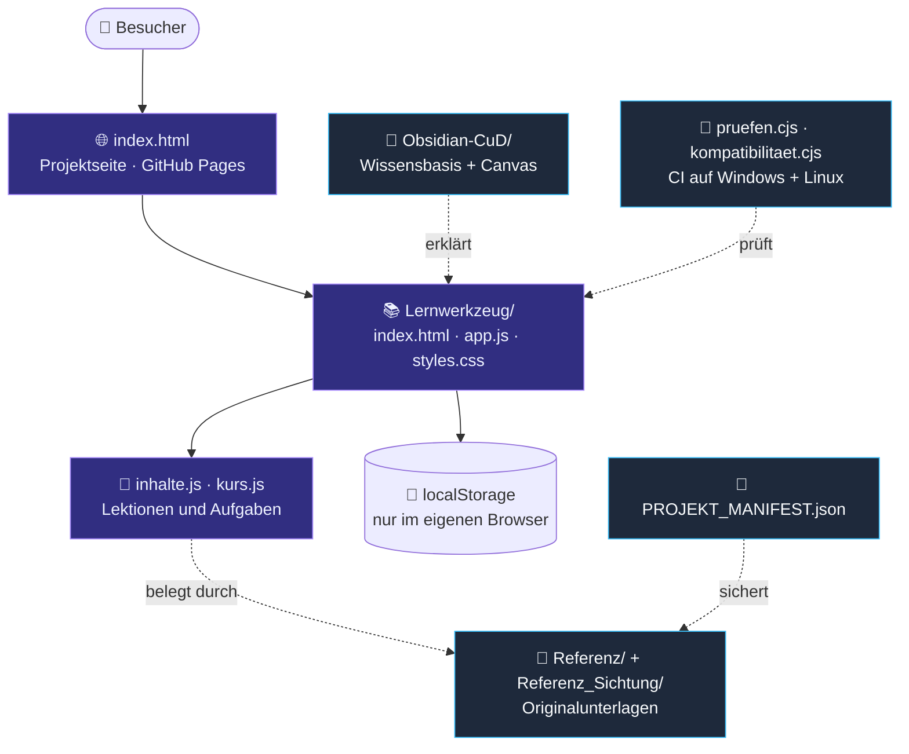

# CuD-1 · Programmieren lernen

  
  
  

Ein lokales Lernwerkzeug für Studierende im Kurs **Coding und Digitalisierung**, auch ohne Programmierkenntnisse: verständliche Vorlesungsetappen, eine Befehlsübersicht, Einrichtungsanleitungen und Begleitung zu allen 31 Aufgaben des vorhandenen Übungsskripts.

Mit Version **0.4.1** gibt es den Lernraum und die Startseite vollständig auf Deutsch, Englisch, Arabisch, Türkisch, Persisch und Ukrainisch; Fachbegriffe und Aufgabenstellungen bleiben Deutsch wie in der Prüfung. Dazu kommen auf beiden Seiten ein dunkles Design, Kopieren-Knöpfe an allen Codebeispielen sowie Links zum Originalkurs in ILU und zu GitHub-Feedback. Lernplan, Wiederholungsrunden und Lektionssprünge aus 0.3.0 bleiben erhalten. Alle 31 Aufgaben des vorhandenen Übungsskripts, vier Live-Übungen und zehn Lernetappen einschließlich FFT bleiben enthalten. Lernkontrollen, lokale Bearbeitungsmarken und ein eigenes Transferprojekt helfen beim Üben.

**Aufgabe → benötigtes Wissen → passender Befehl → selbst ausprobieren → Ergebnis prüfen**

Deinen Python-Code prüfst du selbst; danach setzt du bei Bedarf die Bearbeitungsmarke als eigene Einschätzung. Eine richtige Antwort auf die Verständnisfrage plant eine Wiederholung ein, eine falsche bleibt zum Wiederholen vorgemerkt. **Mein Lernplan** zeigt beides zusammen mit der nächsten Etappe.

**[Online im Lernraum starten](https://sae-l.github.io/CuD/Lernwerkzeug/index.html)** · [Projekt kennenlernen](https://sae-l.github.io/CuD/) · [Offline-Paket v0.4.1](https://github.com/Sae-l/CuD/releases/tag/v0.4.1)

Online öffnest du **Meinen Lernplan**, richtest bei Bedarf Python ein und beginnst mit der ersten Lektion. Die Lernseite benötigt kein Konto. Zum Online-Aufruf brauchst du Internet; die Offline-Nutzung beginnt mit dem vollständigen Download.

## Offline in drei Schritten starten

1. Lade beim [Release v0.4.1](https://github.com/Sae-l/CuD/releases/tag/v0.4.1) das vollständige ZIP und `SHA256SUMS` herunter und entpacke das ZIP vollständig. Für den jeweils veränderlichen Entwicklungsstand gibt es [main als ZIP](https://github.com/Sae-l/CuD/archive/refs/heads/main.zip) oder `git clone https://github.com/Sae-l/CuD.git`. **„Seite speichern“ im Browser reicht nicht aus.**
2. Öffne [index.html](index.html) aus dem entpackten Projektordner und wähle **Lernraum öffnen**. Alternativ öffne [Lernwerkzeug/index.html](Lernwerkzeug/index.html) direkt. Die GitHub-Dateiansicht zeigt nur den Quelltext.
3. Wähle **Meinen Lernplan öffnen**, richte deine Python-Umgebung ein und beginne mit der ersten Vorlesung. **Übungen & Begleitung** führt zu allen Aufgaben; der Block 6.1–6.3 bleibt hervorgehoben.

**Mein Lernplan** zeigt die nächste offene Etappe und fällige **Wiederholungen**. [Entwicklungsplan](ENTWICKLUNGSPLAN.md): verbindliche Designregeln, Lernmethoden, Struktur, Quellenvertrag und nächster Ausbau. Tag, Release und zugehörige CI-Läufe belegen den Veröffentlichungsstand getrennt.

Die Lernwebseite benötigt keine Installation, keinen Paketmanager und kein Konto. Nach dem Herunterladen funktioniert sie lokal und offline. Lass den gesamten Projektordner zusammen, damit die Quellenlinks funktionieren. Deinen Python-Code führst du selbst aus; die Webseite ist eine Lernbegleitung. Externe Downloads und Colab benötigen Internet.

## Handy, Tablet, Windows und Mac

Das Layout passt sich der Fensterbreite an. Auf Handy und Tablet ist der [Online-Lernraum](https://sae-l.github.io/CuD/Lernwerkzeug/index.html) der direkte Einstieg. Auf einem Desktop-Rechner kannst du auch die entpackte Startdatei im Browser öffnen. Auf iOS und Android hängt die lokale Dateiöffnung vom Browser und Dateimanager ab; dazu ist [Android-Problem #10](https://github.com/Sae-l/CuD/issues/10) noch offen. Falls die lokale Ansicht nicht funktioniert, beschreibt die [Geräteanleitung](Lernwerkzeug/README.md#auf-deinem-gerät-öffnen) einen HTTP-Server mit dem **gesamten Repository-Ordner**. Nur `index.html` zu übertragen reicht nicht.

Die automatisierten Browserprüfungen sind in [kompatibilitaet.json](Lernwerkzeug/pruefung/kompatibilitaet.json) dokumentiert: Chromium, Firefox und WebKit auf dem Prüfrechner sowie emulierte Handy- und Tabletgrößen. WebKit auf Windows ersetzt keinen Safari-Test auf einem Mac oder iPad. Echte Geräte, Screenreader und Betriebssysteminstallationen bleiben gesondert zu prüfen. Maßgeblich sind die gespeicherten Ergebnisse und der [Prüfbericht](Lernwerkzeug/pruefung/PRUEFBERICHT.md).

Der zuvor veröffentlichte Stand **v0.3.0**, Commit `b296826`, bestand am 17.10.2026 die [Windows-/Linux-Projektprüfung](https://github.com/Sae-l/CuD/actions/runs/39047674536), den [Release-Workflow](https://github.com/Sae-l/CuD/actions/runs/39047712894) und das [Pages-Deployment](https://github.com/Sae-l/CuD/actions/runs/39047673571). Der gespeicherte lokale Gesamtbericht bleibt wegen eines Firefox-Startfehlers FAIL. Der [CI-Nachweis als JSON](Lernwerkzeug/pruefung/CI_NACHWEIS.json) gehört weiterhin zum früheren Verhaltensstand `74ba715`; er wurde nicht als neuer Testlauf umgeschrieben. Spätere Änderungen benötigen eigene aktuelle Prüfungen.

## Wissensbasis in Obsidian

Die [deutsche CuD-Hauptreferenz](Obsidian-CuD/03%20Projektleitfaden.md) erklärt Zweck, Baugeschichte, wissenschaftliche Grundlagen, Laufzeit und Inhaltserweiterung. Sie verbindet Fehlersymptome mit Codeorten, Reparaturprüfungen und dem Wiederaufbau der Arbeitsumgebung. Ein dokumentierter Abgleich von GitHub, Projektdateien und fünf Projektchats begrenzt die Aussagen nachvollziehbar. Öffne den Unterordner `Obsidian-CuD` als Vault in Obsidian; Community-Plugins sind nicht erforderlich. Die Canvas-Datei enthält die verknüpfte Gesamtkarte. Prüfungen: `python Obsidian-CuD/Pruefung/vault_pruefen.py`.

## Was liegt wo?

Die Projektseite führt zum Lernwerkzeug. Seine Inhalte stützen sich auf die Originalunterlagen, der Lernstand bleibt im eigenen Browser. Die Obsidian-Wissensbasis erklärt den Aufbau, automatische Prüfungen testen ihn, und das Manifest sichert die Dateiintegrität.

| Pfad | Inhalt |
| --- | --- |
| [index.html](index.html) | Startseite für GitHub Pages; verlinkt das Lernwerkzeug und nutzt dessen Schrift und Foto aus `Lernwerkzeug/assets/` |
| [Lernwerkzeug/](Lernwerkzeug/) | Webseite: `index.html`, `styles.css`, `app.js`; Lerninhalte in `inhalte.js` und `kurs.js` |
| [Referenz/](Referenz/) | Unveränderte Kursunterlagen, CSV und Code-Begleitdatei |
| [Referenz_Sichtung/](Referenz_Sichtung/) | [Seitenindex](Referenz_Sichtung/Seitenindex.md), Textauszüge, Originalbilder und Herkunftsnachweise |
| [Lernwerkzeug/pruefung/](Lernwerkzeug/pruefung/) | Browser- und Python-Ergebnisse, Prüfbericht und Screenshots |
| [CONTRIBUTING.md](CONTRIBUTING.md) | Entwicklung einrichten, Änderungen prüfen und beitragen |
| [Abdeckungsplan](Lernwerkzeug/ABDECKUNG.md) | Alle 31 Originalaufgaben, passende Lerntexte und verbleibende Lücken |
| [Erweiterungsanleitung](Lernwerkzeug/ERWEITERN.md) | Neue Vorlesungen, Übungen, eigene Daten und ihre Prüfungen ergänzen |
| [AUDIT.md](AUDIT.md) | Audit, behobene Probleme und verbleibende Grenzen |
| [PROJEKT_MANIFEST.json](PROJEKT_MANIFEST.json) | Dateiintegrität; Prüfung mit `python scripts/manifest.py --check` |

Konfiguration und GitHub-Einstellungen: [REPOSITORY_SETTINGS.md](REPOSITORY_SETTINGS.md). Automatische Prüfungen laufen auf Windows und Linux; Versionen und Release-Ablauf sind im Repository festgelegt.

Für Lernende: [Bedienung](Lernwerkzeug/README.md), [Lernkonzept und Quellenabdeckung](Lernwerkzeug/LERNKONZEPT.md), [Gebrauchstest](Lernwerkzeug/GEBRAUCHSTEST.md). Für die Projektplanung: [Arbeitsplan](ARBEITSPLAN_Lernwerkzeug.md) und [Skill-Recherche](SKILL_RECHERCHE.md).

## Probleme melden und mitarbeiten

[Fehler oder Verbesserung melden](https://github.com/Sae-l/CuD/issues/new/choose). Nenne Version, Gerät, Browser und ob du die Online-Seite, eine entpackte Datei oder einen lokalen Server verwendest. Entferne persönliche Daten aus Screenshots und Protokollen. Für Sicherheitslücken gilt der [Sicherheitsmeldeweg](SECURITY.md).

[Beitragen](CONTRIBUTING.md) · [Umgang miteinander](CODE_OF_CONDUCT.md) · [Barrierearmut und bekannte Grenzen](ACCESSIBILITY.md) · [Rechte und offene Lizenzentscheidung](RECHTE.md).

## Inhaltliche Grenzen

Hinweise und Musterlösungen öffnest du einzeln. Lösungstexte und Zahlenantworten erscheinen nicht in Suchvorschauen. Lerntexte, Miniübungen und Musterlösungen sind selbst erstellt und von Originalaufgaben unterschieden.

**Alle 31 Aufgaben des vorhandenen Übungsskripts sind geführt begleitet.** Vorlesungen 001–003 werden kompakt erklärt; eine zusätzliche FFT-Lektion behandelt den Begleitcode anhand eines eigenen geprüften Beispiels. Die vier Live-Übungen haben eigene Musterlösungen. **bb12024.csv fehlt weiterhin**: Drei Live-Lösungen laufen direkt mit der herunterladbaren, selbst erstellten live-mini.csv; ihre Originalergebnisse bleiben unbestätigt. Der [Abdeckungsplan](Lernwerkzeug/ABDECKUNG.md) zeigt Quellen und Grenzen.

Jede der zehn Lektionen enthält eine Verständnisfrage mit begründeter Rückmeldung. Nach selbst geschriebener und geprüfter Miniübung kannst du eine Bearbeitungsmarke setzen. Sie wird nur im selben Browser gespeichert; bei blockierter Speicherung gilt sie für die Sitzung. Keine Anmeldung, Übertragung oder Synchronisation. Eine Marke ist deine Selbsteinschätzung, kein Kompetenznachweis.

Die Originalaufgabe nennt `sensor_messdaten_projekt.csv`; vorhanden ist `messdaten.csv`. Das Werkzeug verwendet diese vorhandene Datei. Ihre Zuordnung ist nicht vom Kurs bestätigt; die gedruckten Sollausgaben weichen ab. Die inklusive Filtergrenze **0 bis 50** ist eine dokumentierte Arbeitsannahme.

Technische Tests belegen keinen Lernnutzen. Gebrauchstest und vollständige visuelle Folienprüfung stehen aus. Für den fehlenden Datensatz `bb12024.csv` gibt es keinen Laufnachweis. `002_fftpy.sec` bleibt unverändert archiviert; bekannte Codewidersprüche werden in der eigenen FFT-Lektion erklärt. PDF-Seitensprünge hängen vom Betrachter ab; verwendete Originalseiten sind zusätzlich als Bilder verlinkt.

## Aufbewahrung und Rechte

Dieses Repository ist öffentlich zugänglich; diese Sichtbarkeit ersetzt keine Nutzungserlaubnis für fremde Kursmaterialien. Originalunterlagen behalten ihre jeweilige Herkunft; eine übergreifende Lizenz für fremde Kursmaterialien wird hier nicht vergeben. Originaldateien bleiben unverändert, einschließlich des byte-identischen doppelten Analyse-PDFs. `.gitattributes` verhindert automatische Zeilenumwandlungen beim Git-Transfer. Temporäre Arbeitsdateien und lokale Browserprotokolle werden über `.gitignore` ausgeschlossen.

## Änderungen und Wartung

Die Versionsgeschichte mit Bedienfeedback und Gestaltungskorrekturen steht in [RELEASE_NOTES.md](RELEASE_NOTES.md). Betrieb und Architektur: [Bedienung](Lernwerkzeug/README.md). Neue Inhalte und sichere Prüfung: [Erweitern](Lernwerkzeug/ERWEITERN.md) und [Beitragen und Veröffentlichen](CONTRIBUTING.md). Die [Diagnose](AUDIT.md#gestaltung-und-sichere-integration-17102026) trennt lokale Dateidrift von Fehlern im veröffentlichten Stand.
